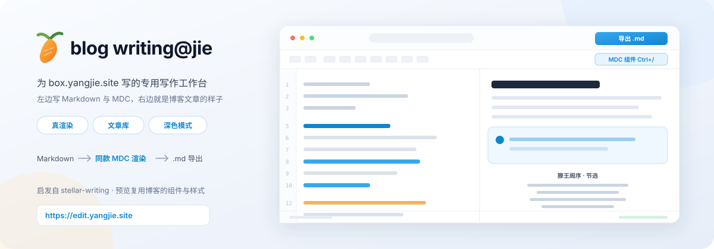

**blog writing@JIE** — 为博客 [box.yangjie.site](https://box.yangjie.site) 写的专用写作工作台

线上地址：**https://edit.yangjie.site**

## 项目启发

从 [stellar-writing](https://github.com/SeqCrafter/stellar-writing) 重构而来。原项目为 Hexo Stellar 主题写了 45 个 `` 标签，本项目换成博客自己的 MDC 组件，复用博客的 remark/rehype 插件和 CSS，预览与线上文章页同源

图标来自 [www.yangjie.site](https://www.yangjie.site) 的胡萝卜

## 有何用

- 左边写 Markdown / MDC，右边实时预览成博客文章的样子
- 一行工具栏插 Markdown 语法，独立组件库插 MDC（`Ctrl+/`）
- frontmatter 表单、文章库（浏览器本地）、导出 `.md` 到 `content/posts/<年>/`
- 深色模式、双向滚动同步、可拖拽分栏、移动端适配，与博客一致的 Shiki / KaTeX / Mermaid 渲染
- **自动保存到浏览器 localStorage**，不上传云端，状态栏显示用量，别清缓存，写完导出 `.md`

## 开发

Node `^22.19 || ^24.11 || >=26`，pnpm `>=10`

```bash
pnpm install
pnpm dev        # http://localhost:3000
```

## 构建

```bash
pnpm typecheck
pnpm build      # 产物 .output（Nitro Node server）
```

预览在浏览器里解析（`@nuxtjs/mdc`），不依赖服务端。EdgeOne 对含 `@nuxt/content` 的项目会强制静态化，API 不转发，所以解析只能放客户端。新增 MDC 插件时，`nuxt.config.ts` 和 `preview-parser.ts` 两处要同步

`edgeone.json` 的 `nodeVersion` 至少 22.19（平台预装 22.21.1 / 24.11.0）。低于 22.12 时 pnpm 会跳过 rolldown 的原生绑定，报 `Cannot find native binding`

## 代码库

- CNB：https://cnb.cool/youngdajie/edit.yangjie.site
- GitHub：https://github.com/youngdajie/edit.yangjie.site

## 协议

[MIT](./LICENSE) © 2026 [youngdajie](https://www.yangjie.site)
